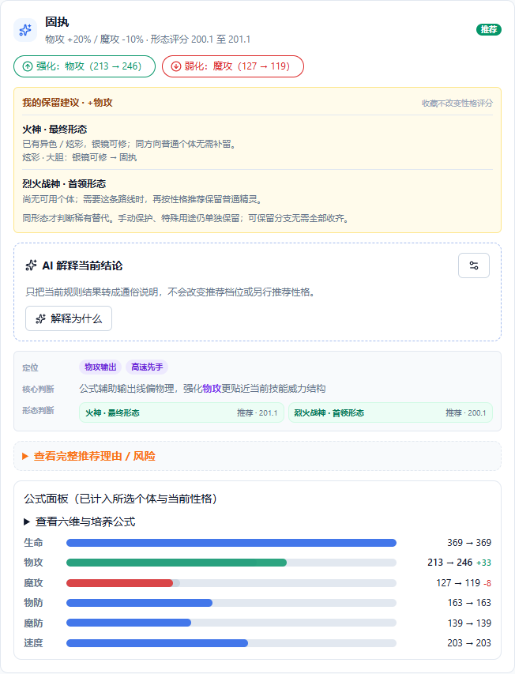
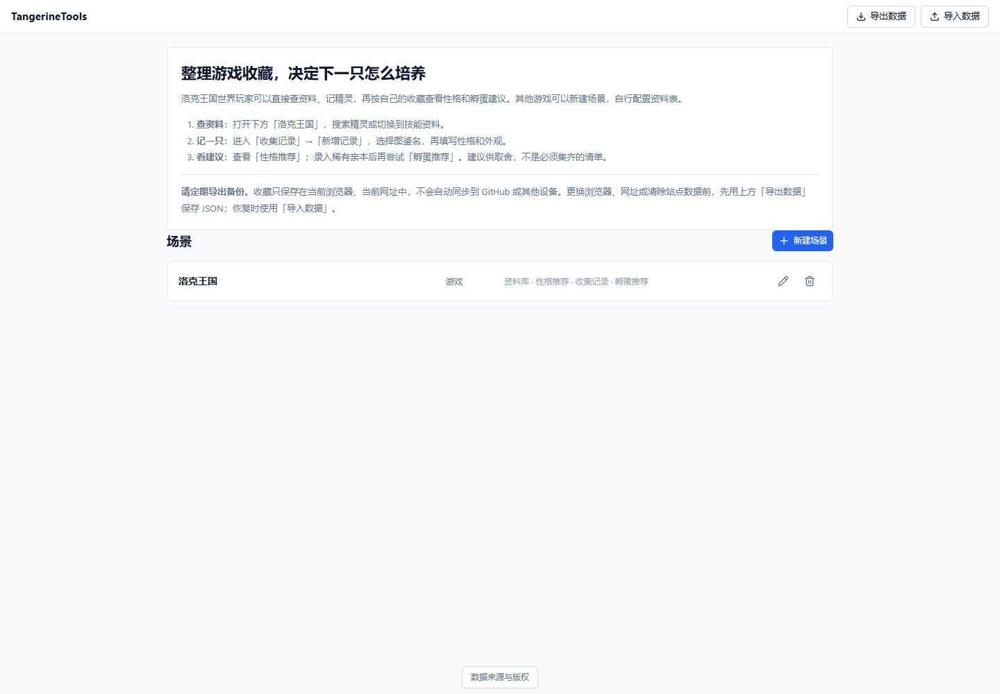

# TangerineTools

**《洛克王国世界》的收藏与培养助手。** 查资料、记录盒子里的精灵，再按自己的收藏判断保留、培养和孵蛋方向。

[在线使用](https://manamiiii.github.io/TangerineTools/) · [Windows 安装说明](docs/windows-desktop.md) · [第一次使用](#第一次使用) · [本地运行](#本地运行) · [问题反馈](https://github.com/Manamiiii/TangerineTools/issues)

无需注册，核心功能不需要 API Key。收藏保存在当前浏览器，通过 JSON 手动备份和迁移。项目处于早期阶段，推荐供取舍，不是必须集齐的清单。

## 在线与本地怎么选

**想直接尝试，用在线版；需要独立窗口，用 Windows 安装版；修改代码时，使用源码版。** 相同代码版本下核心功能一致，各入口的收藏互不共享。

| | 在线版（GitHub Pages） | Windows x64 安装版 | 源码版 |
|---|---|---|---|
| 打开方式 | [浏览器打开](https://manamiiii.github.io/TangerineTools/) | 安装 Setup 后从开始菜单打开 | 启动项目后访问 `http://localhost:5188` |
| 运行要求 | 浏览器，无需源码 | 无需 Node、npm、Python 或 Rust | Node、项目代码和依赖 |
| 使用的版本 | 已部署版本，刷新后加载 | 安装包版本，手动下载并退出后安装更新 | 当前电脑里的代码，自行同步更新 |
| 收藏位置 | 在线网址的浏览器存储 | 本机独立应用数据目录 | 本地网址的浏览器存储 |
| 网络要求 | 加载和更新需要网络；不保证断网可用 | 程序、预置与 OCR 随包提供 | 本机提供程序和预置 |

三种方式都不上传收藏到 GitHub，也不自动同步到其他设备；外部图片和模型服务仍需要网络。Windows 安装版目前是本地验收候选，尚无公开下载附件；验收通过后才发布。维护者可按[桌面构建说明](docs/windows-desktop.md)生成。安装包未签名，不宣称已经验证 macOS、Linux 或 Windows ARM64。

桌面上的**源码启动快捷方式**用于启动这台电脑的开发服务。在线版和安装版都不需要先运行它；安装版有自己的开始菜单入口。

**切换入口：** 先在原入口首页「导出数据」，再到目标入口「导入数据」，核对收集记录后固定使用一个入口。目标已有记录时，先备份目标数据并查看导入覆盖预览；同 ID 记录按备份覆盖，文件未包含的记录保留。来回使用会形成各自的记录，不会自动合并。更换浏览器或设备也需要同样的导出／导入操作。

## 能帮你做什么

| 你的问题 | 在工具里怎么做 |
|---|---|
| 盒子里精灵太多，记不清已有哪种个体 | 查精灵与技能资料，按图鉴名、性格、外观和性别记录、筛选收藏 |
| 普通、异色、炫彩，同方向的个体都要留吗 | 先看性格适用性，再看结合收藏的保留建议；同形态已有正向增益合适、可用银镜调整的稀有个体时，普通个体可作备选 |
| 孵蛋该选哪些亲本 | 根据已记录的稀有亲本、蛋组和目标，查看最多五对候选组合；普通亲本可能需要按条件现抓 |

也支持新建其他游戏场景，自行配置资料表、收集记录与统计；其他游戏没有内置图鉴或专项推荐。

### 性格推荐与“我的保留建议”

下面是实际页面的局部截图：使用两条**演示记录**（普通固执火神、炫彩大胆火神），展示同一培养方向下的银镜调整提示。演示记录不会自动写入你的收藏；工具也不会替你在游戏中放生精灵。



**性格适用性与保留建议分开看。** 收藏会影响“还需要留什么”，不会改变精灵本身的性格评分。手动保护、特殊用途和不同形态仍需分别判断。

## 第一次使用

直接打开 **[在线工具](https://manamiiii.github.io/TangerineTools/)**，无需安装 Node 或下载源码。建议固定使用同一浏览器、同一网址，并收藏该入口。

1. 点击「洛克王国」，在「资料库」搜索一只熟悉的精灵。
2. 切换「收集记录」→「新增记录」，选择图鉴名，按游戏中的实际个体填写性格、外观等信息。
3. 打开「性格推荐」，搜索同一精灵，查看适用性和“我的保留建议”；录入稀有亲本后再尝试「孵蛋推荐」。
4. 点击顶部 TangerineTools 返回首页，使用「导出数据」，在下载列表确认 JSON 文件已保存。

**请定期备份。** 在线使用也只把收藏保存在你的浏览器，不会上传到项目服务器或自动同步到其他设备。清除站点数据、换浏览器或换网址前先导出；到新入口后再导入。

<details>
<summary>查看首页与操作提示</summary>



</details>

## 本地运行

本节是源码运行方式，Windows 安装版不需要这些环境。开发需要 Node.js：建议使用 `.nvmrc` 指定的 22.12.0 或更新的受支持 22.x 版本，最低满足 `package.json` 的 `>=22.12.0`。命令行克隆需要 Git，也可以[下载源码 ZIP](https://github.com/Manamiiii/TangerineTools/archive/refs/heads/main.zip)并解压。

```bash
git clone --depth 1 https://github.com/Manamiiii/TangerineTools.git
cd TangerineTools
npm ci
npm run dev
```

打开终端显示的 **http://localhost:5188**。无需配置环境变量、数据库服务或模型供应商。首次进入会读取仓库内的预置资料，等待初始化完成。

Windows 安装依赖后，也可以双击项目根目录的 `TangerineTools.vbs`。启动窗口会显示阶段和耗时，就绪后打开浏览器；失败原因留在窗口中。首次运行可能受系统脚本策略限制，此时直接使用上面的终端命令即可，不需要管理员权限。日志在 `artifacts/launcher/`。源码下载不附带作者电脑上的桌面快捷方式。

**请先备份，再做批量修改或删除。** 数据按浏览器和网址隔离：`localhost`、`127.0.0.1`、不同端口以及线上站点不是同一份收藏。换网址或设备前先导出，再到目标页面导入。导入按记录 ID 合并：同 ID 整条覆盖，文件未包含的本地记录保留。导入确认窗口可先导出当前数据。

## 限制与常见问题

- **资料不是实时更新**：内置内容来自版本化 Wiki 快照，不是游戏接口。资料批次见页面底部「数据来源与版权」，逐条来源见资料详情；使用时留意游戏版本差异。
- **扫描录入是实验功能**：目前按 3200×1440 横屏游戏画面标定，不能保证适配其他设备或布局；HEVC 视频解码还依赖浏览器和系统。新用户优先手动录入，扫描后仍须逐条复核。参见[扫描说明](docs/rock-kingdom/scanner.md)。
- **加速、减速和培养建议不是对战模拟**：规则读取六维、技能和特性，不计算完整配招、阵容、克制及全部能量循环。可保留分支按需选择；工具不替你在游戏中放生精灵。
- **没有自动云同步**：清除浏览器站点数据、无痕窗口结束或浏览器存储被回收都可能丢失本地记录。请把备份文件保存到浏览器外。
- **核心功能不依赖 AI**：可选的模型解释、扫描文字纠错需要自行配置可信供应商，浏览器直连，可能因 CORS 或费用限制而不可用。详见[模型配置与隐私边界](docs/model-provider-setup.md)。
- **图片不显示**：部分游戏图片引用外部 Wiki 图床；本地优先不等于所有资源都离线可用。网络或来源站点不可用时，文字记录仍可使用。首次初始化和未缓存功能也不承诺离线可用。
- **页面启动失败**：确认网络能读取本站静态文件、浏览器允许站点存储，然后点击「重新尝试」。不要为排错先清除站点数据；已有收藏请先备份。
- **5188 端口被占用**：停止冲突服务后重试。不要随意换端口寻找收藏；新端口使用独立浏览器数据。
- **其他游戏如何配置**：新建场景时启用需要的工具，在「资料库」建立资料表和字段；收集表可添加引用字段关联该表，再录入个人记录。

更多说明：[数据存储与备份](docs/data-sync.md) · [隐私与第三方内容](docs/privacy-and-sources.md)。

## 构建与自行部署

```bash
npm ci
npm run build
npm run preview -- --host localhost --port 5188 --strictPort
```

本地预览前先停止同端口开发服务。部署时上传 **`dist/` 的全部内容**，包括预置、OCR 语言包和运行资源，不能直接双击 `dist/index.html`。支持静态 HTTPS 托管，使用相对资源路径和 hash 路由，无需后端或服务端路由重写。`vite preview` 仅用于本地验收，不作为公网服务器。

仓库包含 `.github/workflows/pages.yml` 的 GitHub Pages 流程：检查、测试、构建通过后部署。Fork 用户需在仓库 Settings → Pages 中选择 GitHub Actions，并自行启用工作流；推送 `main` 或手动触发可能发布站点。仅想本地使用时，不必配置 Pages，也不必运行任何 BWiki 采集或预置发布命令。

开发容器通过 `npm ci` 准备依赖并启动 5188 端口；普通用户不需要 AI 开发工具。作者使用的 Codex 凭据配置只在显式设置 `TANGERINE_ENABLE_CODEX_SETUP=1` 后执行。不要将开发端口设为公开共享。容器启动路径尚需在实际 Codespaces 环境单独验收。

## 开发与维护

前端使用 React 19、Vite 与 Dexie，数据保存在浏览器 IndexedDB。维护者常用：

```bash
npm run lint
npm run check:privacy
npm test
npm run build
```

完整测试包含本机 Chrome 无界面回归，需要已安装 Chrome；Windows 启动器测试只在 Windows 执行。首次安装和依赖审计需要联网。`npm audit` 检查已知依赖通告，不等同于完整安全审计。

本机目录、密钥、内网地址和个人备份不进入仓库。机器参数使用环境变量或 Git 忽略的 `.local/` 等本地配置；提交使用 GitHub noreply 邮箱。可运行 `git config --local core.hooksPath .githooks` 启用暂存区隐私检查（已有自定义钩子时先整合），详见[公开仓库与本机配置](docs/privacy-and-sources.md#公开仓库与本机配置)。

README 截图来自隔离浏览器中的界面回归，不读取个人收藏。PowerShell 可执行 `$env:CAPTURE_PRODUCT_SCREENSHOT='1'; node --test scripts/tests/public-onboarding.test.mjs`，从 `artifacts/quality/product/` 检查输出后，将 `getting-started.png` 与 `nature-retention.png` 放入 `docs/assets/product/`。

<details>
<summary>全部维护命令（普通用户无需执行采集或发布）</summary>

| 命令 | 用途 |
|---|---|
| `npm run lint` | 静态检查 |
| `npm run check:privacy` | 检查跟踪文件和提交邮箱，避免本机配置误入公开仓库 |
| `npm test` | 领域与回归测试 |
| `npm run build` | 生产构建 |
| `npm run dist:windows` | 构建 Windows x64 Setup 和 SHA-256，不发布附件 |
| `npm run pack:desktop` | 构建供验收的 Windows unpacked 程序 |
| `npm run test:desktop` | 在隔离数据下验收打包程序、OCR、安全边界与备份 |
| `npm run build:installer-fixtures` | 顺序构建独立身份的低版本号与当前版本安装 fixture |
| `npm run test:installer` | 独立测试身份的安装、升级、运行中保护与数据保留验证 |
| `npm run test:installer:production` | 正式身份的隔离静默安装验收；既有安装存在时拒绝 |
| `npm run checksums:desktop` | 为当前版本 Setup 生成 SHA-256 与大小清单 |
| `npm run build:icons` | 从 `public/favicon.svg` 导出 PNG、PWA 遮罩图标和 Windows ICO |
| `npm run check:nature` | 生成并检查性格推荐校准报告 |
| `npm run check:scanner:templates` | 检查扫描模板 |
| `npm run apply:scanner:templates` | 显式写入扫描模板 |
| `npm run sync:breeding` | 同步繁育资料 staging |
| `npm run check:official-announcements` | 检查官方版本 / 平衡公告并生成人工复核报告 |
| `npm run sync:bwiki:staging` | 同步 BWiki 基础 staging |
| `npm run sync:bwiki:details` | 同步 BWiki 详情 staging |
| `npm run sync:bwiki:nrc -- --version=S4-2026-09-10` | 同步新版 NRC 候选；默认最多请求 24 个缺失详情，每次等待 30 秒；可用 `--interval=60` 放慢 |
| `npm run import:bwiki:nrc -- --version=版本 --key=页面键 --file=快照.html` | 校验并导入 NRC HTML 快照 |
| `npm run collect:bwiki:browser -- --version=版本 --limit=all` | 本地 Chrome 点击图鉴卡片并双遍读取详情；默认间隔 60 秒，只补同批次缓存缺口 |
| `npm run import:bwiki:nrc -- --version=版本 --key=精灵sourceId --capture=采集记录.json` | 导入经过身份校验与双遍分段比对的浏览器详情记录；保留采集时间 |
| `npm run preview:bwiki:nrc` | 生成 NRC 候选预览与发布阻塞清单 |
| `npm run audit:bwiki:nrc` | 离线比较 NRC 源字段与正式资料，列出身份冲突、技能影响和详情缺口 |
| `npm run review:bwiki:nrc` | 离线验证最终 NRC 候选的完整性、旧 ID、家族、异色及技能引用，生成发布审阅清单；不批准发布 |
| `npm run check:bwiki:nrc` | 检查 NRC 发布条件及绑定具体候选的用户批准 |
| `npm run apply:bwiki:preset -- --source=nrc` | 用户确认并设置覆盖口令后发布 NRC 预置；同步运行时迁移版本，详见 NRC 来源文档 |
| `npm run check:bwiki:sources` | 核对 NRC 正式资料与逐行来源清单 |
| `npm run preview:bwiki` | 构建 BWiki 发布预览 |
| `npm run check:bwiki:preset` | dry-run 检查 NRC 正式预置差异 |
| `npm run apply:bwiki:preset -- --source=rocom` | 显式检查来源的 rocom 发布入口；遗漏正式稳定 ID 时拒绝写入 |

正式预置写入需要明确来源、针对具体候选的批准及 `BWIKI_PRESET_OVERWRITE` 确认值，见 [BWiki 发布流程](docs/data-sources/bwiki-pipeline.md)。不要把普通运行或升级与重新采集、发布资料混淆。

</details>

<details>
<summary>工程目录与维护文档</summary>

### 目录

```text
docs/                         当前能力、数据源与专项规则
desktop/                      桌面安全层、Windows 打包与隔离安装验收
public/presets/               洛克王国运行时正式预置
scripts/bwiki/                官方公告审计与 BWiki staging / preview / apply
scripts/nature/               性格推荐校准
scripts/rock-kingdom-scanner/ 扫描模板维护
scripts/vite/                 本地 OCR 运行资源打包与静态缓存版本
scripts/tests/                自动化回归测试
src/components/               场景和通用工具界面
src/features/                 OCR、模型与洛克王国专项能力
src/hooks/                    异步操作状态与收集表初始化
src/db/                       Dexie、播种、导入导出与迁移
src/presets/                  场景结构定义与版本化来源清单
```

### 维护文档

- [`docs/system-capabilities.md`](docs/system-capabilities.md)：产品范围和已实现能力。
- [`docs/privacy-and-sources.md`](docs/privacy-and-sources.md)：隐私、第三方请求与素材许可边界。
- [`docs/data-sync.md`](docs/data-sync.md)：Dexie、备份、导入与阅读迁移兼容。
- [`docs/windows-desktop.md`](docs/windows-desktop.md)：Windows 安装、身份、安全边界、构建与验收口径。
- [`docs/data-sources/bwiki-pipeline.md`](docs/data-sources/bwiki-pipeline.md)：正式资料发布流程。
- [`docs/data-sources/bwiki-field-mapping.md`](docs/data-sources/bwiki-field-mapping.md)：字段转换、稳定 id 与校验门槛。
- [`docs/data-sources/nrc-source.md`](docs/data-sources/nrc-source.md)：新版 NRC 快照采集、候选边界与署名许可。
- [`docs/data-sources/research-sources.md`](docs/data-sources/research-sources.md)：玩家资料研究边界。
- [`docs/wuhui-huaxia/catalog.md`](docs/wuhui-huaxia/catalog.md)：无悔华夏名臣资料、个人收集模型与来源约束。
- [`docs/nature/rules.md`](docs/nature/rules.md)：性格推荐规则。
- [`docs/nature/single-creature-template.md`](docs/nature/single-creature-template.md)：单精灵审计模板。
- [`docs/nature/open-issues.md`](docs/nature/open-issues.md)：待确认规则问题。
- [`docs/nature/confirmed-results.md`](docs/nature/confirmed-results.md)：确认结论与回归基线。
- [`docs/rock-kingdom/scanner.md`](docs/rock-kingdom/scanner.md)：扫描器契约。
- [`docs/rock-kingdom/scanner-baseline.md`](docs/rock-kingdom/scanner-baseline.md)：扫描回归基线。
- [`docs/model-provider-setup.md`](docs/model-provider-setup.md)：洛克王国模型服务配置。

应用图标源文件为 `public/favicon.svg`；运行 `npm run build:icons` 导出 `public/icons/tangerine-tools-*` 与 Windows ICO。启动入口为 `TangerineTools.vbs`，实现位于 `scripts/windows/`。

</details>

## 问题反馈

通过 [GitHub Issues](https://github.com/Manamiiii/TangerineTools/issues) 提供使用入口、浏览器／系统、操作步骤、预期和实际结果。截图请去掉昵称等个人信息；不要公开 API Key、整份个人备份或原始录屏。资料纠错请附对应的游戏版本与来源页面。

## License 与素材说明

项目自有代码和原创文档采用 **GNU GPL v3.0（GPL-3.0-only，仅第 3 版）**，另有声明的文件除外。完整条款见 [LICENSE](LICENSE)，版权声明与授权范围见 [COPYRIGHT](COPYRIGHT)。

允许使用、修改和商业使用；对外分发受 GPL 覆盖的程序或修改版本时，须按协议保留声明、采用相应许可并提供对应源码。软件按现状提供，不作担保。构建会将 LICENSE、COPYRIGHT 和运行时依赖许可放入 `dist/`；分发构建产物时还应提供与该产物一致的源码和必要构建脚本，不能只链接到不对应的上游版本。

Wiki 文字、游戏图片、扫描样本、OCR 语言包与软件依赖各有其来源和许可范围，不能一并声明为项目代码许可证。页面底部提供来源与版权说明；详细边界见[隐私与第三方内容](docs/privacy-and-sources.md)。TangerineTools 与游戏官方及 Wiki 站点无隶属或授权关系。
